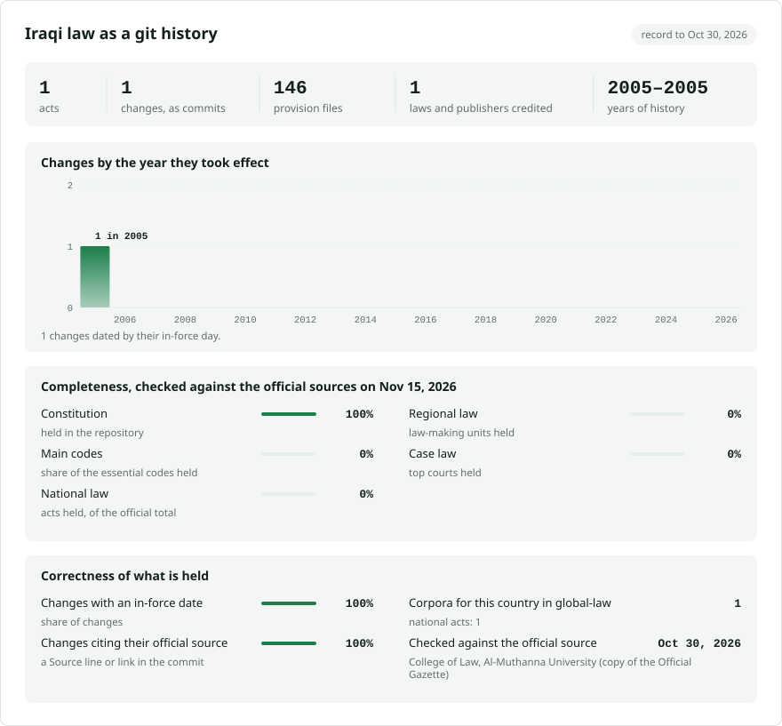

# Iraq: law history in git

[العربية](README.md) · **English**

<picture>
<source media="(prefers-color-scheme: dark)" srcset="data/effort-dark.svg">

</picture>

The law of Iraq as a git history: one file per provision, one commit per version on the day it took effect, and the act that made each change as the commit's author. `git blame` names the act behind every article; `git log` lists every change to an article; picking a date gives the text in force that day.

Part of [lexifina/global-law](https://github.com/lexifina/global-law), one git history for every country's law: this is Iraq's national law, which global-law reads at `iraq/national/acts/`.

**What is in it now:** the Constitution of the Republic of Iraq of 2005 in one version: its preamble and Articles 1 to 144 (145 provisions), as published in the Official Gazette (Al-Waqa'i' Al-Iraqiya no. 4012) on 28 December 2005. No statute, regulation, treaty or court decision is here yet. [`constitution/README.md`](constitution/README.md) lists every provision; [`REPRODUCE.md`](REPRODUCE.md) says how the files were made.

Each act is a folder with one file per provision and one paragraph per line: `constitution/art-001.md` is Article 1 and `constitution/preamble.md` the preamble.

The text is in Arabic, as the Gazette published it, with the vowel marks of the university copy (the Gazette prints them only in part). The English translations of the Constitution are not part of this record.

## Questions as git commands

| Question | Command |
| --- | --- |
| Every change to Article 1 of the Constitution | `git log -p --word-diff -- constitution/art-001.md` |
| Which act wrote each line of Article 1? | `git blame constitution/art-001.md` |
| Every version of the Constitution, with the day each took effect | `git log --format="%h %(trailers:key=In-force,valueonly,separator=) %an" -- constitution ":^constitution/README.md"` |
| Article 1 on 1 January 2026 | `python tools/on.py 2026-01-01 constitution art-001` |

**Outside git**, we also host this record publicly, for free:

- **[Ask Claude about Iraqi law](https://global-law.lexifina.com/v1/try_claude?country=iraq)**: opens Claude with a first question ready.
- **[Ask ChatGPT](https://global-law.lexifina.com/v1/try_chatgpt?country=iraq)**: the same question in ChatGPT.
- **[Search Iraqi law on our site](https://lexifina.com/law?country=iraq&q=%D8%AD%D8%B1%D9%8A%D8%A9+%D8%A7%D9%84%D8%AA%D8%B9%D8%A8%D9%8A%D8%B1)**: a search for "حرية التعبير" (freedom of expression), with each provision's text and its versions, no account needed.
- **[Developer REST API](https://global-law.lexifina.com/v1/search_law?query=%D8%AD%D8%B1%D9%8A%D8%A9+%D8%A7%D9%84%D8%AA%D8%B9%D8%A8%D9%8A%D8%B1&jurisdiction=iraq)**: the same search as JSON, with no key. See the [documentation here](https://lexifina.com/api/global-law).

Both assistants read the record through the free Global law connector (MCP, `https://global-law.lexifina.com/mcp`); the first time, the chat gives you the link that adds it. Ask in Arabic or in English.

**Host it yourself easily.** All it takes is git and Python, and the tools run on your machine:

```sh
git clone --depth 1 https://github.com/lexifina/global-law && cd global-law
python3 tools/countries.py add iraq/national/acts
python3 tools/law.py show 2026-01-01 iraq/national/acts/constitution/art-001.md
```

Opened in Claude Code, Cursor, VS Code or Codex, the clone also starts a local MCP server with the same tools ([MCP.md](https://github.com/lexifina/global-law/blob/main/MCP.md)).

## Dates

Each commit is dated at noon, Asia/Baghdad, on the day the version took effect, and carries it in its `In-force:` trailer:

- the Constitution's one version is dated 28 December 2005, the day the Gazette published it, after its approval by referendum on 15 October 2005 (the `Enacted:` trailer). Article 144 makes it effective after the referendum, its publication and the forming of the government under it; the version is dated by its publication. A date before 28 December 2005 gives no text.

The version is credited to the Constitution itself (`Constitution of Iraq 2005`, `Kind: referendum`), as its original publication. The committer is Lexifina.

## How it is checked

- The text was compared with a second, retyped copy (Arabic Wikisource) and with a scan of the Gazette itself (WIPO Lex), read with OCR as a check only; no OCR text is published. Ignoring vowel marks and hamza forms, the two copies agree on 115 of 144 articles; of the 29 that differ, the text used here matches the scan better in 24, and in the other 5 the difference is one letter.
- `tools/check_repo.py` reads every version back from git on the day it took effect and on the day before and compares it with the corpus, whose hash is in `data/corpus.sha256`; it also checks the trailers, merge commits and future dates. [`REPRODUCE.md`](REPRODUCE.md) records that the checks were not yet run for this build and that no second build has been compared.
- The sha256 of the page the text was parsed from is in `data/versions.json`. Part, chapter and section headings are not kept as files; each article keeps its number.
- [vulnerabilities/](vulnerabilities/README.en.md): possible drafting mistakes in this law, found by global-law's detectors and checked by hand. Not run yet.

## What it does not show

- **Later changes.** Only the Gazette text of 28 December 2005 is here; the corrections the Gazette later printed for a few articles (nos. 4015 and 4017) are not applied.
- **Statutes, regulations, treaties and court decisions.** None yet, and no catalogue of them.
- **The English translations**, which are not used.

## Sources

| Source | Kind | Past versions | Notes |
| --- | --- | --- | --- |
| [College of Law, Al-Muthanna University](https://law.mu.edu.iq/%D8%AF%D8%B3%D8%AA%D9%88%D8%B1-%D8%AC%D9%85%D9%87%D9%88%D8%B1%D9%8A%D8%A9-%D8%A7%D9%84%D8%B9%D8%B1%D8%A7%D9%82-%D9%84%D8%B3%D9%86%D8%A9-2005/) | A university copy of the Gazette text (Al-Waqa'i' Al-Iraqiya no. 4012) | no, one text | Read on 30 October 2026; the page states no terms of use |
| [WIPO Lex](https://www.wipo.int/wipolex/ar/legislation/details/10027) | A scan of the Gazette no. 4012 | no, one text | Used only to check the text |

## Licence

See [`LICENSE`](LICENSE). Iraq Copyright Law no. 3 of 1971, Article 6(3), excludes collections of official documents, such as the texts of laws, from protection, unless a collection is distinguished by originality, arrangement or other personal effort; the text here follows the Gazette, split only into one file per article. Lexifina's arrangement, tables, commit messages and tools are under CC BY 4.0.

No AI model wrote, translated or corrected legal text; the scripts were written by an AI model (see [`REPRODUCE.md`](REPRODUCE.md)).

## Visualisations

- [visualisations/](visualisations/README.en.md): charts drawn from this repository. Not drawn yet.

## More

From [lexifina/global-law](https://github.com/lexifina/global-law):

- [FEATURES.md](https://github.com/lexifina/global-law/blob/main/FEATURES.md): every feature, and what every corpus must support (`git blame`, `law.py`, the MCP tools)
- [FAQ.md](https://github.com/lexifina/global-law/blob/main/FAQ.md): questions and answers · [CONTRIBUTING.md](https://github.com/lexifina/global-law/blob/main/CONTRIBUTING.md): proposing changes · [MCP.md](https://github.com/lexifina/global-law/blob/main/MCP.md): the MCP server · [REPRODUCE.md](https://github.com/lexifina/global-law/blob/main/REPRODUCE.md): how it was built · [CHANGELOG.md](https://github.com/lexifina/global-law/blob/main/CHANGELOG.md)
- [FRESHNESS.md](https://github.com/lexifina/global-law/blob/main/FRESHNESS.md): how current each corpus is · [Monitoring](https://github.com/lexifina/global-law/tree/main/monitoring): whether updates are running · [WATCHING.md](https://github.com/lexifina/global-law/blob/main/WATCHING.md): how each official source is watched for changes
- [performance/](https://github.com/lexifina/global-law/tree/main/performance): how fast the tools are, measured
- [visualisations/](https://github.com/lexifina/global-law/tree/main/visualisations): charts and bridges across the world's law
- [Vulnerabilities](https://github.com/lexifina/global-law/tree/main/vulnerabilities): mistakes in legislation as published
