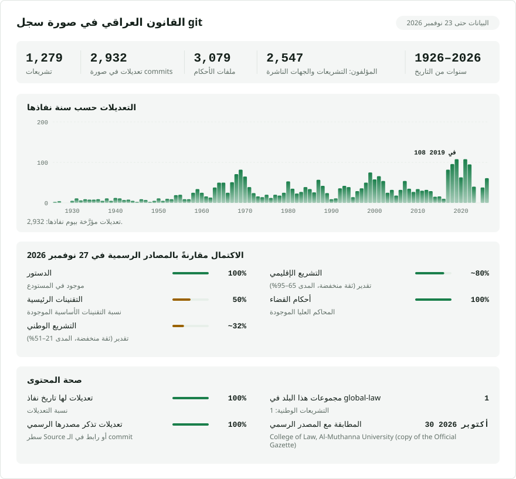

# العراق: تاريخ القانون في git

**العربية** · [English](README.en.md)

<picture>
<source media="(prefers-color-scheme: dark)" srcset="data/ar/effort-dark.svg">

</picture>

القانون العراقي في صورة سجل git: ملف لكل حكم، ولكل نسخة commit واحد في يوم نفاذها، والتشريع الذي أجرى كل تعديل هو مؤلف الـ commit. يبيّن `git blame` التشريع الذي يقف وراء كل مادة؛ ويسرد `git log` كل تعديل طرأ على مادة؛ واختيار تاريخ ما يعطي النص النافذ في ذلك اليوم.

جزء من [lexifina/global-law](https://github.com/lexifina/global-law)، وهو سجل git واحد لقانون كل بلد: هذا هو القانون الوطني العراقي، الذي يقرؤه global-law في `iraq/national/acts/`.

**المحتوى الحالي:** دستور جمهورية العراق لسنة 2005 في نسخة واحدة: ديباجته والمواد من 1 إلى 144 (145 حكمًا)، كما نُشر في الجريدة الرسمية (الوقائع العراقية، العدد 4012) في 28 كانون الأول 2005. ولا يوجد هنا حتى الآن أي قانون أو نظام أو معاهدة أو قرار قضائي. يسرد [`constitution/README.md`](constitution/README.md) كل حكم؛ ويبيّن [`REPRODUCE.md`](REPRODUCE.md) كيف أُعدّت الملفات.

كل تشريع مجلد، فيه ملف لكل حكم وفقرة في كل سطر: `constitution/art-001.md` هي المادة 1 و`constitution/preamble.md` هي الديباجة.

النص باللغة العربية، كما نشرته الوقائع العراقية، مع الحركات الواردة في نسخة الجامعة (إذ لا تطبعها الجريدة إلا جزئيًا). والترجمات الإنجليزية للدستور ليست جزءًا من هذا السجل.

## الأسئلة في صورة أوامر git

| السؤال | الأمر |
| --- | --- |
| كل تعديل طرأ على المادة 1 من الدستور | `git log -p --word-diff -- constitution/art-001.md` |
| أي تشريع كتب كل سطر من المادة 1؟ | `git blame constitution/art-001.md` |
| كل نسخ الدستور، مع يوم نفاذ كل منها | `git log --format="%h %(trailers:key=In-force,valueonly,separator=) %an" -- constitution ":^constitution/README.md"` |
| المادة 1 في 1 كانون الثاني 2026 | `python tools/on.py 2026-01-01 constitution art-001` |

**خارج git**، نستضيف هذا السجل أيضًا للعموم، مجانًا:

- **[اسأل Claude عن القانون العراقي](https://global-law.lexifina.com/v1/try_claude?country=iraq)**: يفتح Claude ومعه سؤال أول جاهز.
- **[اسأل ChatGPT](https://global-law.lexifina.com/v1/try_chatgpt?country=iraq)**: السؤال نفسه في ChatGPT.
- **[ابحث في القانون العراقي على موقعنا](https://lexifina.com/law?country=iraq&q=%D8%AD%D8%B1%D9%8A%D8%A9+%D8%A7%D9%84%D8%AA%D8%B9%D8%A8%D9%8A%D8%B1)**: بحث عن "حرية التعبير"، مع نص كل حكم ونسخه، دون الحاجة إلى حساب.
- **[واجهة REST API للمطوّرين](https://global-law.lexifina.com/v1/search_law?query=%D8%AD%D8%B1%D9%8A%D8%A9+%D8%A7%D9%84%D8%AA%D8%B9%D8%A8%D9%8A%D8%B1&jurisdiction=iraq)**: البحث نفسه بصيغة JSON، دون مفتاح. انظر [التوثيق هنا](https://lexifina.com/api/global-law).

يقرأ المساعدان كلاهما السجل عبر موصِّل Global law المجاني (MCP، `https://global-law.lexifina.com/mcp`)؛ وفي المرة الأولى تعطيك المحادثة الرابط الذي يضيفه. اسأل بالعربية أو بالإنجليزية.

**استضفه بنفسك بسهولة.** كل ما يلزم هو git وPython، والأدوات تعمل على جهازك:

```sh
git clone --depth 1 https://github.com/lexifina/global-law && cd global-law
python3 tools/countries.py add iraq/national/acts
python3 tools/law.py show 2026-01-01 iraq/national/acts/constitution/art-001.md
```

عند فتح النسخة المستنسخة في Claude Code أو Cursor أو VS Code أو Codex، تشغّل أيضًا خادم MCP محليًا بالأدوات نفسها ([MCP.md](https://github.com/lexifina/global-law/blob/main/MCP.md)).

## التواريخ

يحمل كل commit تاريخ الظهيرة، بتوقيت Asia/Baghdad، من اليوم الذي نفذت فيه النسخة، ويحمل هذا اليوم في تذييله (trailer) `In-force:`:

- تحمل النسخة الوحيدة للدستور تاريخ 28 كانون الأول 2005، وهو يوم نشره في الجريدة الرسمية، بعد إقراره في الاستفتاء في 15 تشرين الأول 2005 (التذييل `Enacted:`). تجعل المادة 144 الدستور نافذًا بعد الاستفتاء عليه ونشره وتشكيل الحكومة بموجبه؛ وتُؤرَّخ النسخة بتاريخ نشره. أي تاريخ قبل 28 كانون الأول 2005 لا يعطي نصًا.

تُنسب النسخة إلى الدستور نفسه (`Constitution of Iraq 2005`، `Kind: referendum`)، بوصفها نشره الأصلي. والمُودِع (committer) هو Lexifina.

## كيف يُتحقَّق منه

- قورن النص بنسخة ثانية أُعيدت طباعتها (ويكي مصدر العربية) وبصورة ممسوحة ضوئيًا من الجريدة الرسمية نفسها (WIPO Lex)، قُرئت بالتعرّف الضوئي على الحروف (OCR) للتحقق فقط؛ ولا يُنشر أي نص مستخرج بهذه الطريقة. وبتجاهل الحركات وصور الهمزة، تتفق النسختان في 115 مادة من 144؛ ومن المواد الـ 29 المختلفة، يطابق النص المستخدم هنا الصورة الممسوحة على نحو أفضل في 24، وفي المواد الخمس الأخرى يقتصر الاختلاف على حرف واحد.
- يعيد `tools/check_repo.py` قراءة كل نسخة من git في يوم نفاذها وفي اليوم السابق له، ويقارنها بالمجموعة، التي توجد بصمتها (hash) في `data/corpus.sha256`؛ ويتحقق أيضًا من التذييلات ومن commits الدمج والتواريخ المستقبلية. ويسجّل [`REPRODUCE.md`](REPRODUCE.md) أن عمليات التحقق لم تُشغَّل بعد لهذا البناء وأنه لم تُقارَن به أي عملية بناء ثانية.
- توجد بصمة sha256 للصفحة التي استُخرج منها النص في `data/versions.json`. ولا تُحفظ عناوين الأبواب والفصول والفروع في ملفات؛ وتحتفظ كل مادة برقمها.

## ما لا يُظهره

- **التعديلات اللاحقة.** لا يوجد هنا سوى نص الجريدة الرسمية الصادر في 28 كانون الأول 2005؛ ولا تُطبَّق التصحيحات التي نشرتها الجريدة لاحقًا لبضع مواد (العددان 4015 و4017).
- **القوانين والأنظمة والمعاهدات والقرارات القضائية.** لا يوجد أي منها حتى الآن، ولا فهرس لها.
- **الترجمات الإنجليزية**، فهي غير مستخدمة.

## المصادر

| المصدر | النوع | النسخ السابقة | ملاحظات |
| --- | --- | --- | --- |
| [كلية القانون، جامعة المثنى](https://law.mu.edu.iq/%D8%AF%D8%B3%D8%AA%D9%88%D8%B1-%D8%AC%D9%85%D9%87%D9%88%D8%B1%D9%8A%D8%A9-%D8%A7%D9%84%D8%B9%D8%B1%D8%A7%D9%82-%D9%84%D8%B3%D9%86%D8%A9-2005/) | نسخة جامعية من نص الجريدة الرسمية (الوقائع العراقية، العدد 4012) | لا، نص واحد | قُرئت في 30 تشرين الأول 2026؛ لا تذكر الصفحة أي شروط استخدام |
| [WIPO Lex](https://www.wipo.int/wipolex/ar/legislation/details/10027) | صورة ممسوحة ضوئيًا من الجريدة الرسمية، العدد 4012 | لا، نص واحد | تُستخدم للتحقق من النص فقط |

## الترخيص

انظر [`LICENSE`](LICENSE). يستثني قانون حماية حق المؤلف العراقي رقم 3 لسنة 1971، في المادة 6 (3)، مجموعات الوثائق الرسمية، كنصوص القوانين، من الحماية، ما لم تتميز المجموعة بالابتكار أو الترتيب أو أي مجهود شخصي آخر؛ والنص هنا يتبع الجريدة الرسمية، ولم يُقسَّم إلا إلى ملف لكل مادة. أما ترتيب Lexifina وجداولها ورسائل الـ commits وأدواتها فهي بموجب ترخيص CC BY 4.0.

لم يكتب أي نموذج ذكاء اصطناعي نصًا قانونيًا ولم يترجمه ولم يصححه؛ أما البرامج النصية (scripts) فكتبها نموذج ذكاء اصطناعي (انظر [`REPRODUCE.md`](REPRODUCE.md)).

هذا النص ترجمة للنسخة الإنجليزية ([README.en.md](README.en.md))؛ وعند الاختلاف تسود النسخة الإنجليزية.

## المزيد

من مستودع [lexifina/global-law](https://github.com/lexifina/global-law) (صفحات باللغة الإنجليزية):

- [FEATURES.md](https://github.com/lexifina/global-law/blob/main/FEATURES.md): جميع الميزات، وما يجب أن تدعمه كل مجموعة (`git blame`، `law.py`، أدوات MCP)
- [FAQ.md](https://github.com/lexifina/global-law/blob/main/FAQ.md): أسئلة وأجوبة · [CONTRIBUTING.md](https://github.com/lexifina/global-law/blob/main/CONTRIBUTING.md): اقتراح تغييرات · [MCP.md](https://github.com/lexifina/global-law/blob/main/MCP.md): خادم MCP · [REPRODUCE.md](https://github.com/lexifina/global-law/blob/main/REPRODUCE.md): طريقة البناء · [CHANGELOG.md](https://github.com/lexifina/global-law/blob/main/CHANGELOG.md)
- [FRESHNESS.md](https://github.com/lexifina/global-law/blob/main/FRESHNESS.md): مدى حداثة كل مجموعة · [المراقبة](https://github.com/lexifina/global-law/tree/main/monitoring): هل تعمل التحديثات · [WATCHING.md](https://github.com/lexifina/global-law/blob/main/WATCHING.md): كيف يُراقَب كل مصدر رسمي لرصد التغييرات
- [performance/](https://github.com/lexifina/global-law/tree/main/performance): سرعة الأدوات كما قيست
- [visualisations/](https://github.com/lexifina/global-law/tree/main/visualisations): رسوم بيانية وروابط عبر قوانين العالم
- [الثغرات](https://github.com/lexifina/global-law/tree/main/vulnerabilities): أخطاء في التشريعات كما نُشرت
